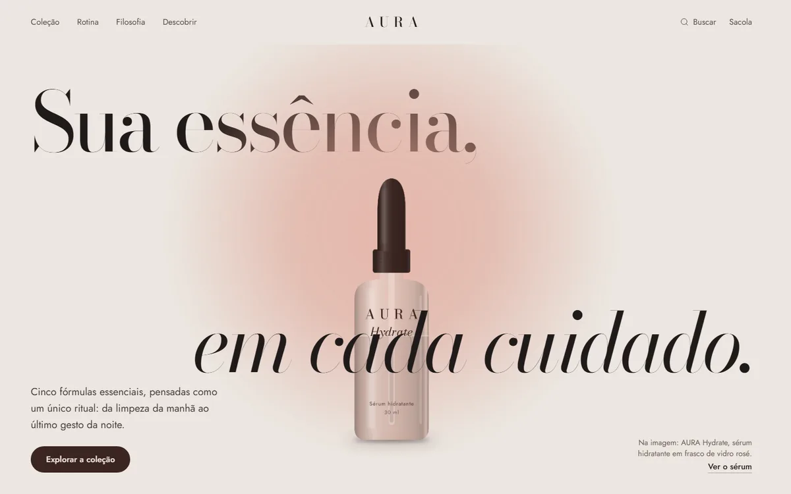

# AURA — Skincare & Beauty

Loja virtual conceitual de skincare desenvolvida pela [Garra Studios](https://garrastudios.online) para portfólio.

**Demo:** https://aura.garrastudios.online



> **Demonstração.** AURA é uma marca fictícia. Produtos, preços, fretes e pedidos são ilustrativos:
> nenhum pagamento é solicitado, nenhum pedido é processado e nenhum dado pessoal é armazenado.
> As imagens são renders ilustrativos, não fotografias de produtos reais.

## O que tem

- Home editorial com nove seções: hero, linha de produtos, destaques, filosofia, categorias,
  destaque do Restore, rotina de manhã e noite (adiciona a rotina inteira), descoberta interativa e newsletter simulada.
- Catálogo `/produtos` com busca, filtros por categoria e preço, ordenação, contagem e estado vazio.
  O estado fica na URL.
- Página de produto com galeria, quantidade, adicionar à sacola, barra fixa de compra no celular e relacionados.
- Sacola lateral persistida no navegador (localStorage), com desfazer ao remover.
- Checkout demonstrativo com validação, frete fictício e confirmação simulada.
- 404 e página de erro próprias, metadata e Open Graph por página, sitemap e robots.

## Rodando

Requer Node 20.9+.

```bash
npm install
npm run dev
```

Abra http://localhost:3000.

```bash
npm run build && npm start   # produção
npm run lint
npm run typecheck
npm run assets               # regenera os renders dos produtos
npm run export               # site estático em out/ (como a demo publicada)
```

Para o deploy, defina `NEXT_PUBLIC_SITE_URL` com a URL pública. O `npm run export` usa
`https://aura.garrastudios.online` por padrão e gera uma pasta `out/` que qualquer servidor
estático (Nginx, por exemplo) consegue servir.

## Stack

Next.js 16 · React 19 · TypeScript · Tailwind CSS 4 · Motion · Zustand · Lucide.

Decisões de arquitetura, design system e critérios de qualidade estão em [CLAUDE.md](CLAUDE.md).
